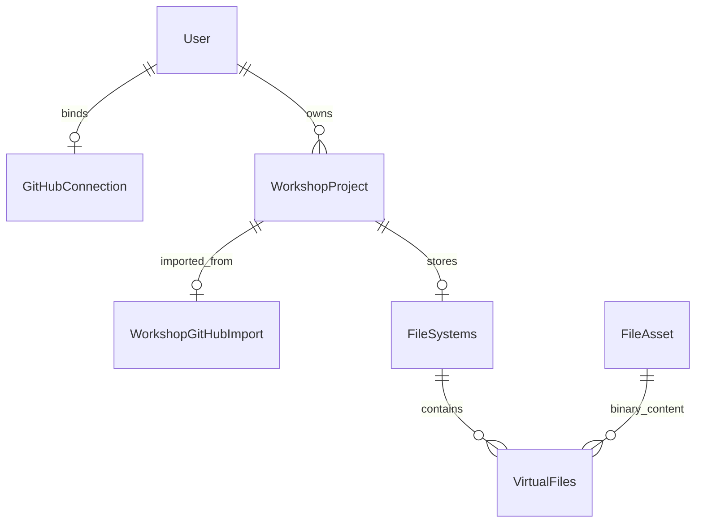

# GitHub 绑定与工坊仓库导入：第一版数据模型

## 范围

- 用户在工坊导入入口或设置页连接自己的 GitHub 账号。
- 导入入口支持公开仓库链接，也支持授权后选择可访问的仓库与分支。
- 将选定提交的文件一次性复制为工坊项目，继续使用现有文件资产与自动保存能力。
- 不实现 Git 拉取、推送、本地提交、持续同步，也不下载或持久化 `.git`。
- GitHub 连接用于访问仓库，不作为新的 Challenge 登录方式，不按 GitHub 邮箱自动合并账号。

本文件记录第一版的模型与实现约定。迁移为 `20261222000000_github_lab_import`。

## 模型关系



新增两张表：`github_connections` 保存绑定和凭据，`workshop_github_imports` 保存项目来源。
仓库列表和安装授权范围从 GitHub 实时查询，不把本地缓存当作权限依据。

## GitHubConnection：账号绑定

```prisma
model GitHubConnection {
  id                    String    @id @default(cuid())
  userId                String    @unique
  githubUserId          BigInt    @unique
  login                 String
  avatarUrl             String?
  accessTokenEncrypted  String?
  accessTokenExpiresAt  DateTime?
  refreshTokenEncrypted String?
  refreshTokenExpiresAt DateTime?
  credentialKeyVersion  Int?
  revokedAt             DateTime?
  createdAt             DateTime  @default(now())
  updatedAt             DateTime  @updatedAt

  user User @relation(fields: [userId], references: [id], onDelete: Cascade)

  @@map("github_connections")
}
```

- 一个 Challenge 用户最多绑定一个 GitHub 账号，一个 GitHub 账号最多绑定一个 Challenge 用户。
- 绑定身份使用不可随用户名修改的 GitHub 数字 ID；`login` 和头像仅作展示缓存。
- GitHub ID 使用 `BigInt`，API 对外转换为十进制字符串，避免 JSON 序列化问题。
- 凭据使用服务端认证加密，密钥和 App 私钥放在服务端环境配置中；密文包含 nonce 和认证标签，版本字段支持密钥轮换。
- 设置页、工坊页只返回明确选择的公开字段和连接状态，不返回 token、密文或密钥版本。
- 授权撤销后清空两类凭据及到期时间，设置 `revokedAt`，保留身份用于提示重新连接。
- 用户主动解绑时删除连接记录；已导入的文件和项目来源保留。再次绑定另一账号时必须重新验证 GitHub 身份。
- 刷新凭据按连接 ID 串行化，避免并发刷新使 token 轮换结果互相覆盖。
- 不复用现有 `Auth.accessToken`：本功能是第三方仓库连接，需要独立的凭据生命周期和最小字段返回。

## WorkshopProject：明确创建来源

```prisma
enum WorkshopProjectSource {
  template
  github
}

// 在现有 WorkshopProject 上修改 / 添加：
// source     WorkshopProjectSource @default(template)
// templateId String?
// githubImport WorkshopGitHubImport?

// 在现有 User 上添加：
// githubConnection GitHubConnection?
```

- 老项目保持 `source = template` 和原 `templateId`，无需改写现有文件。
- GitHub 导入项目使用 `source = github`、`templateId = null`，不伪装成空白模板。
- SQL 增加约束：模板来源必须有非空模板 ID；GitHub 来源必须没有模板 ID。
- `source` 为创建来源，不因解绑账号或仓库删除而改变；第一版不支持转换来源。
- 不把导入的仓库注册为 `WorkshopTemplate`，避免私人仓库内容进入公共模板列表。

## WorkshopGitHubImport：一次性导入来源

```prisma
model WorkshopGitHubImport {
  projectId       String   @id
  repositoryId    BigInt
  ownerLogin      String
  repositoryName  String
  visibility      String
  branchName      String
  commitSha       String
  importedAt      DateTime @default(now())

  project WorkshopProject @relation(fields: [projectId], references: [id], onDelete: Cascade)

  @@index([repositoryId])
  @@map("workshop_github_imports")
}
```

- 一条记录对应一次成功导入，与项目一对一；同一仓库允许多次导入为不同项目，均占用用户项目额度。
- 仓库身份使用数字 `repositoryId`；owner/name/visibility 是导入时快照，不代表当前远端状态或访问权限。
- `visibility` 保存 GitHub 返回的 `public`、`private` 或 `internal`，不把“公开”解释为拥有开源许可证。
- `branchName` 记录用户选定分支；先解析 `commitSha`，再按该 SHA 下载，避免下载期间分支移动导致内容混杂。
- `commitSha` 是来源记录，不是同步游标；项目修改后也不更新。
- 仓库链接从 owner/name 派生，无需重复保存 URL；后续远端查询优先使用仓库 ID。
- 不关联 `GitHubConnection`：导入后文件属于项目所有者，解绑、授权撤销不会删除或冻结已有项目。
- 不保存“拥有者有权限”“App 可访问”等永久标记；每次远端请求重新检查当前用户与 App 的实际授权。

## App 安装与授权临时状态

第一版不新增安装表或用户—安装权限关系表。

- GitHub App 安装可能属于个人或组织，同一安装可以被多个用户访问，不应建成每人一个安装。
- 用当前用户的授权查询安装及其可访问仓库；即使客户端提交 `installationId`，服务端也必须重新验证。
- App ID、slug、Client ID、Client Secret、私钥和 Webhook Secret 属于服务端配置，不作为用户数据库记录。
- OAuth `state`、PKCE verifier、发起用户 ID、返回目标和有效期保存在 Redis；回调状态只消费一次。
- 返回目标使用预定义的工坊 / 设置页标识，不接受任意外部跳转地址。
- Webhook 先验签；撤销授权时根据 GitHub 用户 ID 清理凭据。安装事件用于使短期仓库列表缓存失效，不授予本地权限。
- Webhook 操作保持幂等；不涉及项目自动同步，无需订阅 push。第一版没有仓库列表缓存，安装变更后直接查询实时授权。

## 创建事务与文件一致性

1. 校验当前 Challenge 用户，以及项目数量额度；匿名访问仓库失败只能表述为“仓库不存在或需要授权”。
2. 解析仓库身份、分支及提交 SHA，按大小、文件数和总耗时限制下载该提交的内容。
3. 排除 `.git`、`node_modules`，拒绝越界路径；第一版遇到符号链接、子模块或 Git LFS 指针时明确提示不支持，不静默丢弃或伪装成已导入完整内容。
4. 复用 `VirtualFiles` / `FileAsset` 保存文本和二进制；文件模式 / 可执行位当前未建模，作为导入兼容性限制，不承诺完整克隆语义。
5. 下载与资产准备完成后开启短事务：沿用用户创建 advisory lock，再次检查每人 20 个项目的上限，创建项目、来源记录、文件系统和文件记录。
6. 实际文件体积沿用现有 20MB 单文件、100MB 单项目配置；下载压缩包也需独立限制压缩体积、解压体积与条目数量。
7. 创建失败不留下半成品项目；事务外准备但未被引用的资产按现有清理机制回收。
8. 导入项目默认不自动安装依赖或执行仓库脚本，由用户在工坊终端主动操作。

导入请求第一版采用有超时、容量上限的同步操作；如果实际部署网关时限无法满足，再增加有幂等键的异步导入任务表。

## 重置、删除与接口适配

- 模板项目保持原来的“重置为模板”行为。
- GitHub 项目第一版隐藏并在服务端拒绝模板重置；不因点击重置重新下载远端仓库。
- 项目列表 / 编辑器返回创建来源和导入摘要，用于展示 GitHub 来源，不强行查找模板。
- 删除项目级联删除来源记录，文件与资产沿用现有清理流程。
- 解绑账号只撤销 Challenge 保存的连接，不代表卸载用户或组织中的 GitHub App；界面分别说明并提供 GitHub 管理入口。

## 实施与迁移顺序

1. 先调整使用 `templateId` 的服务、列表、编辑器与重置接口，使其支持可空值及来源分支。
2. 添加枚举、两张新表、`source` 字段及约束，生成 Prisma 客户端与 name-map；不重置数据库，不改写已应用迁移。
3. 完成绑定 / 回调 / 解绑 / 凭据刷新和 Webhook，再接入仓库列表、分支选择和导入服务。
4. 最后接入工坊导入弹窗、设置页绑定卡片及项目来源展示。

关键验证：重复绑定冲突、OAuth 回调重放、撤销授权、token 并发刷新、未授权仓库、分支下载一致性、二进制内容、路径越界、体积限制、并发创建额度、失败回收，以及旧模板项目的创建和重置回归。

## 配置和本地验证

配置位于 `packages/challenge-web-app/.env`，变量模板见同目录 `.env.example`。
Nuxt 中集中定义在服务端 `runtimeConfig.github` 对象下；以下变量均支持去掉 `NUXT_` 前缀的 `GITHUB_*` 简写，Nuxt 原生变量优先。简写在服务运行时读取，不将凭据写入构建配置。

| 变量 | 来源 |
| --- | --- |
| `NUXT_GITHUB_CLIENT_ID` | GitHub App 设置页的 Client ID |
| `NUXT_GITHUB_CLIENT_SECRET` | GitHub App 设置页生成的 Client Secret |
| `NUXT_GITHUB_APP_SLUG` | App 公开页 `https://github.com/apps/<slug>` 的最后一段 |
| `NUXT_GITHUB_WEBHOOK_SECRET` | 自己生成，并与 GitHub App Webhook 设置的 Secret 保持一致 |
| `NUXT_GITHUB_TOKEN_KEY` | Challenge 自己生成的数据库凭据加密密钥，不是 GitHub App 的配置项或私钥 |
| `NUXT_GITHUB_ORIGIN` | 本地 `http://localhost:3001`，线上为实际 HTTPS 站点 origin |

`NUXT_GITHUB_TOKEN_KEY` 使用 `openssl rand -base64 32` 生成，一次生成后稳定保存。
当前只使用版本 1 的密钥，不能直接替换正在使用的密钥；更换需先实现数据重加密或要求用户重新授权。
GitHub App 私钥与 App ID 在本版本的用户授权流程中不需要，不接收客户端提交的安装 token。

- Callback URL：`<ORIGIN>/api/auth/github/callback`。
- Setup URL：`<ORIGIN>/api/auth/github/setup`；不勾选安装时自动请求 OAuth，勾选安装更新后返回。
- Webhook URL：`<公开 HTTPS ORIGIN>/api/webhooks/github`；启用 Active，Secret 与配置一致。开发时使用公网 HTTPS 隧道。
- Contents 和 Metadata 只需读取权限；无需 push 事件或写权限。
- 允许其他账号安装，才能让其他 Challenge 用户连接自己的仓库。
- 配置更新后重启开发服务；部署时 Compose 已传递这些变量。

未配置 App 时仍允许公开仓库链接导入，连接按钮会明确显示不可用状态。
仓库下载经服务端完成；默认最多 5000 个条目、100MB 压缩包、120MB 解压归档，再按工坊单文件 / 总文件容量限制校验。

选择分支后，先通过 Git Trees API 读取固定提交的目录与文件大小，展示可展开的目录树、目录汇总大小及预计导入总量。
`.git` 和 `node_modules` 标记为不导入，不计入预计导入总量；目录汇总大小包含全部子文件。
预计导入总量不得超过 100 × 1024 × 1024 字节或配置的项目上限（取较小值），同时检查单文件上限。
目录树被截断、超过 5000 条、大小不完整，或包含不受支持的符号链接 / 子模块时，禁用导入。
导入请求携带预览的提交 SHA；服务端重新读取分支与目录，若提交变化则要求刷新预览，并在下载归档前拦截超限项目。
归档下载及解压后的容量、安全检查继续保留。

导入界面使用现有 `StDrawer` 抽屉和 `StSteps` 展示三个阶段：选择仓库、检查文件、确认导入。
操作按钮固定在抽屉底部，中间内容独立滚动；移动端沿用底部抽屉布局并预留安全区。
公共仓库输入通过与服务端共用的地址格式校验后，底部“下一步”即可点击；点击或按回车后读取仓库，成功后进入文件检查阶段，失败时保留输入并提示原因。
每次只显示当前阶段的表单，并提供上一步以保留选择和项目名称；确认阶段汇总仓库、分支、文件数及容量。
目录预览复用 `StFileSystemTree` 的排序、文件类型图标和递归展开交互，使用只读模式关闭拖拽，并通过 `item-extra` 插槽展示大小和排除标记。

运行 `pnpm --filter @challenge/app test:github` 验证路径、压缩包与凭据处理。
集成测试必须连接专用的本地 `quanta_github_import_test` 数据库，并显式设置独立的 `/tmp/quanta-github-test-*` 存储目录；它模拟 GitHub 响应，覆盖绑定、凭据刷新、授权重放和导入事务，不需要真实 token。
