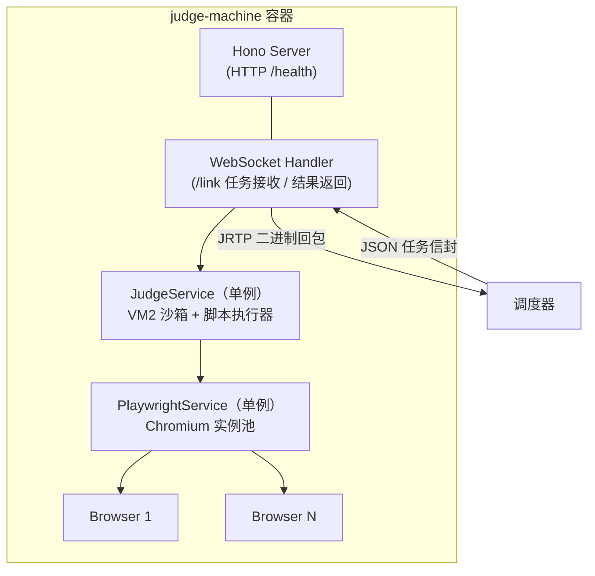

# @challenge/judge-machine-agent

Quanta Challenge 的前端题型自动化评测服务。基于 Playwright 执行判题脚本，在 VM2 沙箱中访问用户页面、断言行为与视觉，并通过 JRTP 协议把结果回传给评测调度器。

后端服务题型另有专用判题机（`backend-judge-machine`，无 Playwright），两者任务信封与回包格式一致。

## 目录

- [概述](#概述)
- [架构](#架构)
- [核心功能](#核心功能)
- [通信协议](#通信协议)
- [判题脚本 API](#判题脚本-api)
- [开发指南](#开发指南)
- [Docker 部署](#docker-部署)

## 概述

判题机运行在 Docker 容器中，通过 WebSocket 与调度器通信。收到评测任务后，用 Playwright 打开用户代码运行的页面（URL 由调度器给出，指向 live-server 容器的网络别名），在沙箱中执行预定义的判题脚本，收集测试点结果、截图与缓存文件后回传。

### 主要职责

- 接收评测任务请求（Zod 校验）
- 用 Playwright 访问目标页面（导航由判题机负责，脚本没有 `page.goto`）
- 在 VM2 沙箱中执行判题脚本
- 收集测试点结果、首屏截图（audit 模式）与缓存文件
- 通过 JRTP 协议返回评测结果

## 架构



## 核心功能

### 1. Playwright 服务

- **浏览器池管理**：维护多个 Chromium 实例，支持并发评测
- **页面生命周期管理**：自动创建和销毁页面上下文
- **健康检查**：定期检测浏览器实例状态

### 2. 评测服务

- **任务验证**：Zod 校验评测任务数据
- **沙箱执行**：VM2 隔离环境运行判题脚本，只注入 `page` 与 `$` 两个句柄
- **结果收集**：汇总测试点结果、截图和缓存文件
- **相似度比对**：jimp 做 audit/judge 两阶段快照图像比对

### 3. JRTP 传输协议

Judge Result Transfer Protocol，专为评测结果设计的二进制协议，支持高效传输包含 Buffer 数据的复杂对象（实现在 `protocol/judge-result-transfer-protocal.ts`）：

```
[JSON长度(4字节)] + [JSON数据] + [Buffer数据...]
```

## 通信协议

### WebSocket 连接

- **端点**：`/link`（容器内监听 3000，宿主机映射 1889；调度器经 `JUDGE_MACHINE_WS_URL` 连接）
- **消息格式**：JSON（任务请求） / JRTP Binary（评测结果回包）

### 任务请求格式

```typescript
interface TaskPayload {
  judgeRecordId: string;    // 评测记录 ID
  judgeScript: string;      // 判题脚本代码
  mode: 'audit' | 'judge';  // 评测模式
  url: string;              // 目标页面 URL（live-server 容器地址）
  info?: CacheFileInfo;     // 缓存文件信息（judge 模式）
}
```

### 评测结果格式

```typescript
// 成功结果
interface JudgeSuccessResult {
  type: 'success';
  judgeRecordId: string;
  judgeTime: number;
  results: CheckPointResult[];
  firstScreen?: Buffer;    // 首屏截图（audit 模式）
}

// 错误结果
interface JudgeErrorResult {
  type: 'error';
  message: string;
  judgeTime: number;
}
```

## 判题脚本 API

判题脚本在 VM2 沙箱中执行，沙箱只注入两个句柄（`page` 与 `$`），入口必须是
`export default defineTestHandler(...)`（判题机把 `export default ` 文本改写成 `const run = `）：

```typescript
export default defineTestHandler(async ({ page, $ }) => {
   // page: Playwright 的 Page（去掉了 goto，导航由判题机负责）
   //   - 额外提供 page.waitForNetworkIdle({ timeout })，见下
   // $: 评测辅助方法

   $.defineCheckPoint('检查点名称', 10, async () => {
      $.expect(条件, '期望 X，实际 Y'); // 断言失败抛错 → 该检查点 fail
      return 10;                       // 必须 return 本检查点得分，否则记 0 分
   });

   // 快照：audit 模式存图，judge 模式与出题时存下的图比相似度
   await $.saveOrCompare({
      type: 'image',
      buffer: await page.screenshot(),
      name: 'main.png',
   });
});
```

#### `page.waitForNetworkIdle({ timeout })`

等网络静默：在途请求归零并保持 500ms 后 resolve `true`，超时 resolve `false`（不抛错）。

Playwright 自己没有这个能力：`waitForLoadState('networkidle')` 依赖导航期的 lifecycle
事件，页面加载完之后再调用会立即返回，点一次按钮再等就等不到东西。

```js
const idle = page.waitForNetworkIdle({ timeout: 5000 }); // 先挂等待（默认 3000，上限 5000）
await page.click('#load-more');                          // 再触发请求
$.expect(await idle, '点击后 5s 内网络仍未结束');
```

- 只统计**调用之后**发出的请求，所以顺序必须是"先挂等待、再触发动作"。
- `timeout` 上限 5000ms：脚本总预算只有 20s（见 `src/services/judge.ts`），一次等待
  吃掉一半预算，后面的检查点会被硬超时一起作废。
- 超时返回 `false` 而不是抛错，由调用方用 `$.expect` 决定要不要判失败 ——
  脚本级异常会让**所有**检查点一起作废。
- 它只保证"请求已结束"，不代表渲染完成；断言前仍应 `waitForSelector` 等目标元素。

## 开发指南

### 前置条件

- Node.js >= 20，pnpm >= 9
- Docker（构建镜像需要，镜像内已含 Chromium）

### 本地开发

```bash
# 仓库根安装依赖后
cd packages/challenge-agents/judge-machine

npx playwright install chromium   # 本机运行才需要；镜像构建走 Dockerfile
pnpm dev                          # vite 开发服务器
pnpm build                        # vite build → dist/
pnpm typecheck                    # tsc --noEmit
```

### 项目结构

```
judge-machine/
├── protocol/                    # JRTP 传输协议（也是包的对外导出）
│   ├── index.ts
│   └── judge-result-transfer-protocal.ts
├── src/
│   ├── index.ts                 # 应用入口
│   ├── controllers/             # HTTP/WS 控制器
│   ├── events/                  # 事件定义
│   ├── lib/                     # 核心库（system.ts 评测系统 API、judge-script.ts）
│   ├── schemas/                 # Zod（task / judge-result）
│   ├── services/                # judge.ts 评测服务、playwright.ts 浏览器池、temp-file.ts
│   └── utils/
├── Dockerfile
├── vite.config.ts
└── package.json
```

## Docker 部署

### 构建镜像

```bash
# 仓库根执行，或本包内 pnpm docker:build
pnpm --filter @challenge/judge-machine-agent docker:build

pnpm --filter @challenge/judge-machine-agent docker:build:proxy   # 走代理
```

支持 `--build-arg APT_MIRROR=mirrors.aliyun.com` 与 `NPM_REGISTRY` 覆盖镜像源。

### 镜像信息

- **镜像名称**：`challenge-judge-machine-agent`
- **基础镜像**：`ubuntu:22.04` + Node.js v22.23.1 官方二进制 + 全局 `playwright@1.54.1`（含 Chromium）+ pnpm 9
- **容器端口**：3000（`/link` WebSocket 与 `/health`）；调度器创建容器时映射到宿主机 1889
- **上下文**：整仓（`../..`），镜像内按 workspace 包安装与构建

该镜像不由 Compose 编排（compose 中带 `profiles: [ignore]`），由调度器在运行期通过 Docker API 创建容器，因此必须**预先构建**；只跑后端题型时可以不构建（调度器会降级运行）。

## API 参考

| 方法 | 路径 | 说明 |
|------|------|------|
| GET | `/health` | 健康检查 |
| GET | `/link` | WebSocket 升级端点（调度器连接用） |

### 关键服务

#### PlaywrightService

```typescript
class PlaywrightService {
  async init(instanceCount: number): Promise<void>;   // 初始化浏览器池
  async openPage(url: string): Promise<{              // 打开新页面
    context: BrowserContext;
    page: Page;
    close: () => Promise<void>;
  }>;
  async healthCheck(browserIndex: number): Promise<boolean>;
}
```

#### JudgeService

```typescript
class JudgeService {
  async init(resourceBaseUrl: string): Promise<void>;             // 初始化服务
  async handleTask(options: IEventMessage['MESSAGE']): Promise<void>;  // 处理评测任务
}
```
