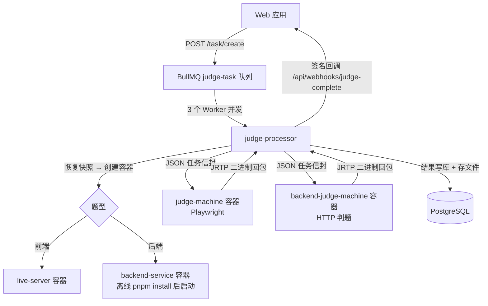

# @challenge/judge

Quanta Challenge 的评测调度服务，负责接收 Web 应用的评测请求、维护 BullMQ 任务队列、通过 Docker API 创建判题相关容器，并协调判题机与数据库之间的通信。

## 目录

- [概述](#概述)
- [判题流程](#判题流程)
- [核心功能](#核心功能)
- [开发指南](#开发指南)
- [Docker 部署](#docker-部署)
- [API 参考](#api-参考)
- [环境变量](#环境变量)

## 概述

调度器是评测系统的核心调度层：接收评测请求、放入 BullMQ 队列、按题型启动对应容器并通过 WebSocket 把任务发给判题机，最终把结果写库并回调 Web 应用。

### 主要职责

- 接收和验证评测任务请求（Zod 校验）
- 管理 BullMQ 任务队列（队列名 `judge-task`，3 个 Worker 并发）
- 创建和销毁 live-server / backend-service 题目容器
- 维护与前端、后端两台判题机的 WebSocket 连接
- 处理评测结果：写库、生成首屏缩略图（thumbhash）、回调 Web 应用
- 管理判题快照临时文件与共享 pnpm 缓存

### 判题流程



前端题型与后端题型使用不同容器链路，但任务信封与回包格式一致。判题机容器由调度器在运行期通过 Docker API 创建（宿主机端口 1889 / 1891），镜像需预先构建；前端判题机镜像缺失时调度器降级运行（`/health` 返回 `degraded`），后端题型不受影响。

## 核心功能

### 1. 任务队列管理

基于 BullMQ：

- **并发控制**：3 个 Worker 并发处理 `judge-task` 队列
- **响应超时**：等待判题机回包 30 秒超时后任务失败
- **结果兜底**：`TASK_COMPLETED` / `TASK_FAILED` / `TASK_ERROR` 三类事件统一处理，`TASK_ERROR`（如 Redis 瞬时故障、不携带 job）只记日志，不改判题记录状态

### 2. Docker 容器管理（Docker outside of Docker）

调度器容器挂载 `/var/run/docker.sock`，直接操作宿主机 Docker daemon：

- **网络管理**：创建和维护 `orange-network` Docker 网络（判题容器与题目容器都接入）
- **live-server**：每个前端任务一个独立容器运行用户静态站点，等容器打印 `Ready`，网络别名即容器访问地址（`http://<alias>:3000`）
- **backend-service**：恢复快照 → 用题目镜像热更新共享 pnpm 缓存 → 启动容器（只读 store 离线安装）→ 等容器打印 `[quanta] Ready`（默认 90s 超时，`BACKEND_SERVICE_START_TIMEOUT_MS` 可调）
- **判题机**：前端判题机（`challenge-judge-machine-agent`，容器 3000 → 宿主机 1889）、后端判题机（`challenge-backend-judge-machine-agent` → 1891，懒加载，首次后端任务才创建）
- **资源上限**：题目容器与判题机容器均设置 Memory / CpuShares / PidsLimit，环境变量可覆盖（见下文）
- **残留清扫**：定时（默认 30s）清扫未被登记的孤儿题目容器；任务失败路径也有按网络别名反查的兜底清理

### 3. WebSocket 通信与 JRTP

- 与判题机保持长连接，30s 心跳保活
- 回包使用 **JRTP**（Judge Result Transfer Protocol）二进制协议，支持含 Buffer 数据的复杂对象（协议实现见 `packages/challenge-agents/judge-machine/protocol/`）

### 4. 共享 pnpm 缓存

后端题型依赖离线可复现安装，调度器是缓存的唯一写入方：

- `POST /cache/update`：从 external / internal registry 把 project 或 packages 预热进 store（用题目容器镜像执行，保证 postinstall 产物与消费侧一致）
- `POST /cache/verify`：门禁——用题目镜像起断网 + 只读 store 的容器跑 `pnpm install --offline`，过期直接拒绝
- `GET /cache`：查看缓存路径、pnpm 版本、上游、体积与上次预热元数据

详见 `docs/PNPM_CACHE.md`。

### 5. 文件系统服务

- 快照恢复：把用户代码快照恢复为文件系统，作为 bind mount 交给题目容器
- 评测产物存储：首屏截图（生成 thumbhash）、检查点缓存文件写入 local_store（与 Web 应用共享卷）

### 6. 监控指标

`GET /metrics` 输出 API 埋点（`@challenge/observation/instrumentation`）与判题业务指标，由 Prometheus 抓取：

| 指标 | 类型 | 说明 |
| --- | --- | --- |
| `judge_queue_depth{queue,state}` | Gauge | 队列各状态任务数 |
| `judge_machine_available{kind}` | Gauge | 判题机可用性 1/0 |
| `judge_results_total{mode,outcome}` | Counter | 判题结果计数 |
| `judge_task_duration_seconds{mode,outcome}` | Histogram | 单任务耗时 |
| `judge_task_pending_seconds{mode}` | Histogram | 队列等待时长 |

## 开发指南

### 前置条件

- Node.js >= 20，pnpm >= 9
- Docker >= 24
- Redis >= 7，PostgreSQL >= 16
- 已构建前端判题机镜像（只跑后端题型可不构建，见降级说明）

### 本地开发

```bash
# 仓库根安装依赖后
cd packages/challenge-judge-scheduler

pnpm dev     # vite 开发模式（启动 MQ 与服务依赖）
pnpm build   # vite build → dist/
pnpm start   # node dist/index.js（需 NODE_ENV=production 才监听 HTTP）
```

> 注意：`src/index.ts` 只在 `NODE_ENV=production` 时启动 HTTP 监听，开发模式只初始化队列与服务。Compose 部署时环境里已设 `NODE_ENV=production`。

依赖初始化失败会显式退出（而非带着不可用状态继续跑），常见原因会打印在日志里：PostgreSQL/Redis 未就绪、1889 被残留判题机容器占用、前端判题机镜像不存在。

### 降级运行

两种情况调度器会降级启动而不是退出：

1. 前端判题机镜像不存在（`no such image`）——视为"此环境不跑前端题型"
2. `JUDGE_MACHINE_OPTIONAL=1`——显式选择（也用于绕过 1889 端口被占）

降级时启动打 WARN、`/health` 返回 `status: degraded`，前端题型提交以
`Judge machine WebSocket is not connected` 明确失败，后端题型不受影响。

### 项目结构

```
challenge-judge-scheduler/
├── src/
│   ├── index.ts                 # 入口：初始化服务，NODE_ENV=production 时监听 HTTP
│   ├── controllers/             # HTTP 路由
│   │   ├── index.ts             # Hono 应用组装、/health、/metrics
│   │   ├── task.ts              # POST /task/create
│   │   ├── code.ts              # POST /code/extract（判题脚本 export default 改写）
│   │   └── cache.ts             # GET /cache、POST /cache/update、POST /cache/verify
│   ├── mq/
│   │   ├── index.ts             # 队列与 Worker 初始化
│   │   ├── result-handler.ts    # 结果事件 → 状态更新 + Web 应用回调
│   │   └── judge-processor/     # 评测处理器（容器编排、发任务、写库）
│   │       ├── index.ts
│   │       ├── db.ts
│   │       └── types.ts
│   ├── metrics/                 # prom-client 判题业务指标
│   ├── services/
│   │   ├── docker.ts            # 容器与网络管理、资源上限、残留清扫
│   │   ├── queue.ts             # BullMQ 队列/Worker 封装
│   │   ├── redis.ts             # Redis 连接
│   │   ├── compile.ts           # 判题脚本预处理
│   │   ├── pnpm-cache.ts        # 共享 pnpm 缓存（预热 / 门禁 / 容器挂载）
│   │   ├── temp-file.ts         # 快照恢复与临时文件
│   │   └── timing.ts            # 启动与判题各阶段计时
│   ├── events/                  # 事件类型
│   ├── filters/                 # 全局异常过滤器
│   ├── middlewares/             # env 加载
│   ├── schemas/                 # Zod 校验（task / compile / cache / job）
│   └── utils/                   # prisma、事件发射器、local-store 等
├── Dockerfile
├── vite.config.ts
└── package.json
```

## Docker 部署

### 构建镜像

```bash
pnpm docker:build          # 标准构建
pnpm docker:build:proxy    # 走代理构建
```

### 镜像信息

- **镜像名称**：`challenge-judge-scheduler`
- **基础镜像**：`node:24-slim`（含 openssl 与 node-gyp 编译工具链）
- **端口**：1888（容器内，`PORT` 可覆盖）
- **入口**：先 `prisma migrate deploy`（幂等，带 advisory lock）再启动服务，部署时无需手工迁移
- **必需挂载**：`/var/run/docker.sock`（Docker outside of Docker）、`TEMP_DIR` 与宿主机共享的同路径 bind mount、pnpm 缓存目录

容器本身由仓库根 `docker/docker-compose*.yaml` 编排，不推荐单独 `docker run`。

## API 参考

### HTTP 端点

| 方法 | 路径 | 说明 |
|------|------|------|
| POST | `/task/create` | 提交评测任务（入队） |
| POST | `/code/extract` | 判题脚本预处理（`export default` 改写） |
| GET | `/cache` | 查看 pnpm 缓存现状 |
| POST | `/cache/update` | 预热 pnpm 缓存 |
| POST | `/cache/verify` | 缓存门禁校验（离线安装可复现性） |
| GET | `/health` | 健康检查（判题机不可用时返回 `degraded`，仍是 200） |
| GET | `/metrics` | Prometheus 指标 |

### 提交评测任务

```json
POST /task/create
Content-Type: application/json

{
  "problemId": 1,                          // 题目 ID
  "judgeRecordId": 123,                    // 评测记录 ID
  "userId": "user-id",                     // 用户 ID
  "judgeScript": "export default ...",     // 判题脚本
  "fsSnapshot": { "path": "content" },     // 文件系统快照
  "mode": "audit"                          // audit | judge
}
```

响应 `201`：

```json
{ "message": "Task created and queued successfully", "jobId": "1" }
```

### 评测结果回调

任务终态后调度器向 Web 应用发起签名回调：

- 路径：`GET {APP_SERVER_URL}/api/webhooks/judge-complete?recordId=<judgeRecordId>`
- 签名：`generateOpenApiSign`（HMAC，密钥 `OPENAPI_WEBHOOK_SECRET`，与 Web 应用共享），以 cookie 形式携带 timestamp 与 sign

## 环境变量

| 变量名 | 说明 | 默认值 |
|--------|------|--------|
| `DATABASE_URL` | PostgreSQL 连接字符串 | - |
| `REDIS_HOST` / `REDIS_PORT` / `REDIS_PASSWORD` | Redis 连接 | `localhost` / 6379 / - |
| `PORT` | HTTP 监听端口 | `1888` |
| `NODE_ENV` | 必须为 `production` 才监听 HTTP | - |
| `APP_SERVER_URL` | Web 应用地址（判题结果回调） | `http://localhost:3000` |
| `OPENAPI_WEBHOOK_SECRET` | 回调签名密钥（与 Web 应用共享） | `default_secret` |
| `JUDGE_MACHINE_WS_URL` | 前端判题机 WebSocket | `ws://localhost:1889/link` |
| `BACKEND_JUDGE_MACHINE_WS_URL` | 后端判题机 WebSocket | `ws://localhost:1891/link` |
| `JUDGE_MACHINE_OPTIONAL` | 置 `1` 时前端判题机不可用也允许启动（降级） | - |
| `TEMP_DIR` | 判题快照目录（须与宿主机同路径共享） | - |
| `PNPM_CACHE_DIR` | 共享 pnpm 缓存目录 | `/app/pnpm-cache` |
| `PNPM_CACHE_PROBLEM_IMAGE` | 缓存预热/门禁用的题目容器镜像 | - |
| `BACKEND_SERVICE_START_TIMEOUT_MS` | 后端服务容器就绪超时 | `90000` |
| `LIVE_SERVER_MEMORY_MB` / `_CPU_SHARES` / `_PIDS_LIMIT` | live-server 容器资源上限 | 512 / 512 / 256 |
| `JUDGE_MACHINE_MEMORY_MB` / `_CPU_SHARES` / `_PIDS_LIMIT` | 前端判题机资源上限 | 2048 / 1024 / 512 |
| `BACKEND_SERVICE_MEMORY_MB` / `_CPU_SHARES` / `_PIDS_LIMIT` | 后端服务容器资源上限 | 1024 / 1024 / 256 |
| `BACKEND_JUDGE_MACHINE_MEMORY_MB` / `_CPU_SHARES` / `_PIDS_LIMIT` | 后端判题机资源上限 | 1024 / 1024 / 256 |
| `CF_SERVER` / `CF_INTERNAL_KEY_ID` / `CF_INTERNAL_SECRET` | 云函数服务地址与内部密钥 | - |

## 评测模式

### Audit 模式（题目审计）

- 运行参考解，生成首屏截图作为标准答案
- 缓存测试点结果供后续 judge 模式比对
- 验证判题脚本的正确性，结果写回题目状态（`ready` / `invalid`）

### Judge 模式（用户判题）

- 加载 audit 阶段缓存的测试点结果
- 与用户提交比对，计算得分并记录
- 结果通过签名回调同步给 Web 应用（排行榜与通知由 Web 侧处理）
