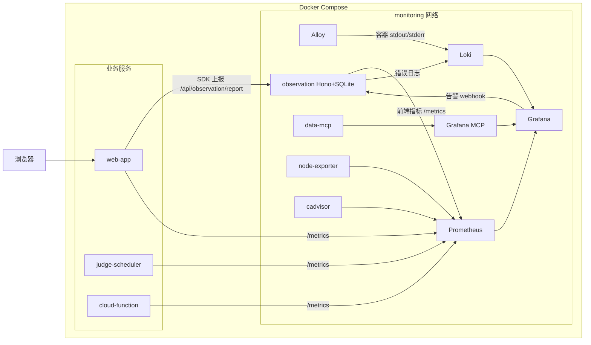

# @challenge/observation

指标采集（Prometheus）、日志采集（Loki + Alloy）、可视化与告警（Grafana），外加一个自研采集服务（observation），负责前端 SDK 上报聚合、错误日志转发和告警记录落库（SQLite）。

## 架构

| 组件 | 职责 | 数据保留 |
| --- | --- | --- |
| Prometheus | 抓取主机/容器/后端 `/metrics` 与前端上报指标 | 15 天或 5GB |
| Loki | 容器日志 + 前端异常日志 | 14 天 |
| Grafana Alloy | 采集所有 Docker 容器 stdout/stderr → Loki | - |
| node-exporter | 主机 CPU/内存/磁盘/网络指标 | - |
| cadvisor | Docker 容器资源指标 | - |
| Grafana | 可视化、Dashboard、统一告警（webhook → SQLite） | Grafana 自身 SQLite |
| observation | 前端 SDK 上报聚合为 Prometheus 指标、错误转发 Loki、业务配置 KV、告警记录（SQLite） | 永久，随备份保留 |
| data-mcp | 统一只读查数 MCP：数据库安全视图 + Grafana 指标/日志工具 | 审计 SQLite |

监控栈接入业务网络 `quanta-challenge_quanta-challenge-network` 抓取后端 `/metrics`。

### 数据流



## 目录结构

```
packages/challenge-observation/
├── Dockerfile
├── scripts/
│   ├── build.mjs                  # esbuild 打包 server / sdk
│   ├── init-data-dirs.sh          # 初始化 data/ 目录并修正属主
│   ├── backup.sh / restore.sh     # 备份与恢复
├── src/
│   ├── server/                    # Hono + node:sqlite
│   │   ├── routes/report.ts       # POST /api/v1/report（SDK 上报）
│   │   ├── routes/config.ts       # /api/v1/config（业务配置 KV）
│   │   ├── routes/alerts.ts       # /api/v1/alerts（告警记录 + Grafana webhook）
│   │   ├── metrics.ts             # prom-client 前端指标
│   │   └── loki.ts                # 错误事件批量转发 Loki
│   ├── instrumentation/hono.ts    # 后端 API 埋点中间件（请求量/错误率/延迟）
│   └── sdk/                       # 前端 SDK（零依赖）
│       ├── index.ts               # initObservation：异常/API 追踪
│       ├── reporter.ts            # 批量上报 + sendBeacon 兜底
│       └── performance.ts         # Web Vitals (LCP/FCP/TTFB/INP/CLS)
└── deploy/
    ├── docker-compose.yml
    ├── .env.example               # 复制为 .env
    ├── prometheus/targets/backends.json   # 后端抓取目标（file_sd，30s 自动刷新）
    ├── loki/loki-config.yml
    ├── alloy/config.alloy
    └── grafana/
        ├── dashboards/            # 预置：主机与容器 / 后端 API / 前端质量
        └── provisioning/alerting/ # 告警规则 / 联系点 / 通知策略
```

## 快速开始

前置：Linux VPS + Docker Engine（compose v2），业务栈（`docker/docker-compose.yaml`）先启动。

```bash
cd packages/challenge-observation

# 1. 环境变量：修改 GRAFANA_ADMIN_PASSWORD、OBS_API_TOKEN
cp deploy/.env.example deploy/.env
# 将 OBS_API_TOKEN 同步写入 deploy/grafana/provisioning/alerting/contact-points.yml
# 的 authorization_credentials，否则告警无法落库
# 启用查数 MCP 前，还需按 ../challenge-data-mcp/README.md 创建数据库只读角色、
# Grafana Service Account，并填写 DATA_MCP_* / GRAFANA_MCP_* 变量。

# 2. 初始化数据目录（Linux 必须执行）
bash scripts/init-data-dirs.sh

# 3. 启动
docker compose -f deploy/docker-compose.yml --env-file deploy/.env up -d --build

# 4. 验证
docker compose -f deploy/docker-compose.yml ps
curl -s http://127.0.0.1:9310/healthz
```

Grafana 地址 `http://<VPS-IP>:13000`（默认绑定 127.0.0.1），账号为 `.env` 中 `GRAFANA_ADMIN_USER/PASSWORD`。

## 业务接入

三个业务服务均已接入，以下是接入方式。

### 后端（Hono：judge-scheduler / cloud-function）

```ts
import { createApiInstrumentation } from '@challenge/observation/instrumentation'

const api = createApiInstrumentation({ service: 'challenge-judge-scheduler' })
app.use('*', api.middleware) // 放在所有业务路由之前
app.get('/metrics', api.metricsHandler)
```

judge-scheduler 额外暴露判题业务指标（`src/metrics/index.ts`）：

| 指标 | 类型 | 说明 |
| --- | --- | --- |
| `judge_queue_depth{queue,state}` | Gauge | BullMQ 队列各状态任务数 |
| `judge_machine_available{kind}` | Gauge | 判题机可用性 1/0 |
| `judge_results_total{mode,outcome}` | Counter | 判题结果计数 |
| `judge_task_duration_seconds{mode,outcome}` | Histogram | 单个判题任务耗时 |
| `judge_task_pending_seconds{mode}` | Histogram | 队列等待时长 |

### 前端（web-app / Nuxt）

- `app/plugins/observation.client.ts` 调用 `initObservation`，采集 JS 异常 / Web Vitals / fetch+XHR 追踪；
- SDK 同源上报到 `/api/observation/report`，由 Nitro 服务端转发到 observation 服务（生产环境 observation 仅绑定回环地址，浏览器无法直连）；
- `server/middleware/metrics.ts` + `server/routes/metrics.get.ts` 提供 Nitro HTTP 指标与 `/metrics`。

web-app 环境变量：

| 变量名 | 说明 | 默认值 |
| --- | --- | --- |
| `OBSERVATION_SERVER_URL` | observation 服务地址（服务端转发用） | `http://localhost:9310` |
| `OBSERVATION_ENDPOINT` | 浏览器上报地址 | `/api/observation/report` |
| `OBSERVATION_SAMPLE_RATE` | 采样率 0-1 | `1` |
| `OBSERVATION_REPORT_TOKEN` | 与服务端 `OBS_REPORT_TOKEN` 一致的上报令牌（可选） | 空 |
| `RELEASE_VERSION` | 发布版本标识 | `dev` |

监控栈未部署时上报静默失败，不影响业务。

## 鉴权

- Grafana：账密由 `.env` 注入，已关闭注册与匿名访问；公网访问需反代 + TLS。
- observation 管理接口（`/api/v1/config`、`/api/v1/alerts`）：必须携带 `OBS_API_TOKEN`（`Authorization: Bearer` 或 `x-obs-token`）。
- 上报接口 `POST /api/v1/report`：可选 `OBS_REPORT_TOKEN`，设置后 SDK 初始化传 `token`。
- 所有端口仅绑定 `127.0.0.1`。

## 数据持久化

bind mount 到 `deploy/data/`：

| 目录 | 内容 | 属主 (uid) |
| --- | --- | --- |
| `data/prometheus` | 指标 TSDB | 65534 |
| `data/loki` | 日志 chunks/索引 | 10001 |
| `data/grafana` | Grafana SQLite | 472 |
| `data/alloy` | 采集游标 | root |
| `data/observation` | `observation.sqlite3`（配置 + 告警记录，WAL） | 1000 |
| `data/data-mcp` | 查数 MCP 调用审计 `audit.sqlite3`（WAL） | 1000 |

保留期：Prometheus `15d` / `5GB`，Loki `336h`（14 天），SQLite 中 `alert_events` 按需手动清理。

## 告警

- 规则在 `deploy/grafana/provisioning/alerting/rules.yml`（Grafana 统一告警，无 Alertmanager），已内置：主机失联 / CPU / 内存 / 磁盘 / 容器重启 / API 5xx / P95 延迟 / 前端 JS 异常激增 / 判题机不可用 / 队列积压 / 判题异常率；
- 告警经 webhook 写入 SQLite（`alert_records` / `alert_events`），REST 查询：

```bash
curl -H "Authorization: Bearer $OBS_API_TOKEN" http://127.0.0.1:9310/api/v1/alerts?status=firing
```

- 邮件/钉钉/飞书/Slack 联系点可在 Grafana UI 中添加。

## 备份与恢复

```bash
bash scripts/backup.sh                 # 打包 deploy/data，停机数秒，输出到 backups/
bash scripts/restore.sh backups/observation-backup-20260101-040000.tar.gz

# crontab 每天 04:00
0 4 * * * cd /path/to/packages/challenge-observation && bash scripts/backup.sh
```

`backups/` 建议异地同步（rclone 到对象存储即可）。

## 常用运维

```bash
cd packages/challenge-observation/deploy
docker compose ps                                   # 状态
docker compose logs -f prometheus                   # 排查某组件
docker compose restart alloy                        # 修改 alloy 配置后生效

# 验证数据链路
curl -s http://127.0.0.1:9310/metrics | grep frontend_errors_total
docker compose exec prometheus wget -qO- 'http://loki:3100/ready'
```

## 资源与扩展

- 资源限制见 compose `deploy.resources.limits`，整栈峰值约 3GB 内存，2C4G VPS 可承载；
- 网络：`monitoring`（internal，内部互通）+ `app`（external，仅 Prometheus 与 observation 加入用于抓取后端）；
- 扩展预留：Alloy 可加 OTLP receiver 接收 Traces/Metrics；Loki derivedFields 已预留 `trace_id` 映射，可追加 Tempo；Prometheus/Loki 预留 `object_store` 抽象可切 S3。
